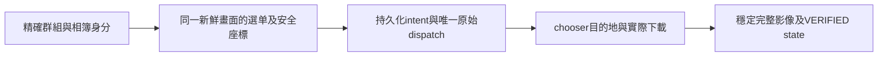

```text
你接手的是「完成可重用的 LINE macOS 原生自動相簿備份流程」，不是重下載已完成的相簿，也不是只交付一個能擷取影像的工具。請先讀完整份 20261006_handoff.md，按其中證據索引讀實際檔案，再繼續本機修復與必要驗收。

權威專案 root 是 /Users/hsiaojohnny/Documents/ChatGPT/Line_backup；所有新備份只能位於此 root 的 backups 下。禁止詢問、搜尋、採用或寫入舊外部備份位置。Canonical group 是「旻謙允禎成長日記」，禎 U+798E，不是楨 U+6968。

57 張、2024/05/13~05/17 相簿已完成：57 JPEG、17,924,900 bytes，state revision16 VERIFIED，writer/context 已釋放，正式獨立驗收 PASS。不得再下載此 fingerprint。整套 native 流程仍 NOT_ACHIEVED；geometry/ownership/occlusion/currentComposer/PhaseB 與舊 entitlement 未滿足或 UNKNOWN。PRIMARY_NATIVE_COMPOSITION 3/3 保留且不可重設，不能換 task/run/session/branch/output 取得第4次 production attempt。

現在不需要使用者將 LINE 放到前景。上一個新同意只批准一次 LINE 主視窗/候選 child 影像及全域支持視窗 metadata 的被動觀察，已執行且消耗；累計 child 觀察2次。最近一次 exit77 的原因是尺寸檢查：水平 residual -46.5/-46.5 pt，垂直0，allowed1；公式推得總寬差 -93 pt。没有完整 PNG/bundle/manifest，只留下 claim。不能宣稱沒發生內部擷取，也不能宣稱已證實漏掉popup或哪一側被裁掉。失敗報告已獨立接受，但 context BLOCKED/packet FAIL 沒被豁免。不要重跑舊 invoke_once.py、不要沿用歷史 PID1091、window ID或座標。

當前51-file Core/CLI source aggregate 是 0dbb74c16ddfe4dd1dc6d7381ec2a1f9f8abc0680656374b83f0e2e9fea7cabf。最新本機修復只在 invalidFrameGeometry 拒絕中補上既有 recorded numeric dimensions/scale，不改 guard、容忍值、擷取或權限。實際 red 1 test/5 failures、focused green39/0、CLI build與61253項保留性 PASS；最新 physical CLI SHA為1c356d59b4518a0f12203f3e45ed20613082aa5414cac154ebd05399f0a3eb11。它不是最新 native 成功證據。用 source manifest核對實際bytes，不要用Git HEAD tree冒充當前source。

目前續作入口是 harness-development/rev28-explicit-window-plan/TASK-f52e92b56c01401e85b9d13864f6ae11/。這只是 CRITICAL 本機方案：新增 explicitLineWindows diagnostic-only、native packet formatVersion3，明列 exact LINE windows的filter與effective crop/witness，保留舊v1/v2，production factory先行拒絕這個新profile。新profile未實作。獨立P1因usage limit中斷，沒有正式RESULT或PASS，沒有exactHandoff，也沒有新的protected-profile決策。先處理 reviewer的未完成finding：v3 witness/request→effective binding必須在session返回成功、completedCaptures增加之前驗證，不能只在load時驗證。原Plan尚未按這個finding修訂。保存原Plan/contract/baseline後做Planner修訂，重取真正獨立P1；有實際PASS後才copy byte-identical Handoff，按凍結gate處理必要的新public/data-contract決策，再實作與獨立A1。不要把未完成review訊息偽造成正式bounded-action或PASS。

本文件與其context-handoff task是使用者後來明示要求的新文件寫入，會落在較早pending Plan的全量baseline之外。接手應保存舊baseline、明確記錄合法新增文件，再產生修訂Plan的新baseline；不能直接重跑舊prepare.py，不能忽略真正的source/state/Git差異。舊history、failures、quotas、slots/ledger/anchor全保留；不reset/clean/stash或切分支。

使用者隨後明示授權本交接文件add/commit；§15記錄其限定scope。本文HEAD/index是文件編寫及提交前的歷史觀察，提交後必須實讀Git並參照publication receipt，不要求回退。另已發現舊DOC_TASK角色結果沿用78f source metadata；實際已核對的current source仍是0db，差異詳見§15，不得以舊metadata作當前source acceptance。

使用者已授權自主規劃及同範圍本機修復，不要每個角色再問一次。變更protected architecture/security/data/public契約、擴大相簿/不可逆動作或取得新的實機scope仍需具體方案與必要決策。此本機proposal native/GUI/input/network固定0；任何未來實機仍要新明示grant，不可使用已消耗的同意。只有真正需要介入時才一次用白話說明正確畫面，不再反覆叫使用者開LINE。

依使用者AGENTS.md Harness4.7.0/format3及line-album-backup skill執行。CRITICAL需独立P1→exactHandoff→Implementer→独立A1，root串行、helpers/writers0。controller/native admission不可用就誠實提供advisory結果，不手動推state或假造OS/provider/model receipts。reviewer用量/能力不足時保存 blocker，不能自審代替獨立gate。只有整套必要實作、驗證與獨立驗收都满足才宣告整套DONE。
```

# LINE 相簿備份：2026-10-06 詳細續作交接

文件日期：2026-10-06，Asia/Taipei。編寫前實讀時間為 2026-10-06 00:53:33 UTC（08:53:33 Taipei）。本文件是現在的**續作導航與事實交接**，不是 repair Plan、production permit或新的pixel同意。

使用者本輪最後要求是停止在本對話繼續堆疊工作，整理詳細、準確的 dated handoff，以便新對話接手。本輪只交付文件及文件任務證據，沒有續作新profile或重啟review。原根目錄 [handoff.md](handoff.md) 保留原bytes：其授權、較早repair/57張備份與歷史證據仍有效，但其49-file「current source」等描述已是歷史；本文件補齊之後51-file與最新pending Plan的狀態。

## 1. 使用者真正目標、成果與現在的操作狀態

最終目標是可靠、可重用、可驗收的 LINE macOS 原生相簿備份：正確尋找相簿、辨認儲存全部選單、以持久化的at-most-once規則派送、處理chooser、核對實際照片、登錄VERIFIED並釋放owner。使用者不是只要示範，也不希望不斷協助開前景或猜選單。

已完成的單一相簿與尚未完成的原生系統必須分開：

| 主體 | 狀態與界線 |
|---|---|
| 2024/05/13~05/17、57張 CUA backup transaction | DONE/VERIFIED、正式獨立A1 PASS，不可重下載 |
| 主視窗原生擷取/實際OCR的歷史診斷 | 有有效實機packet，不證明popup、當前校準或全套執行 |
| childUnion v2 本機collector/profile | 本機實作與歷史獨立A1 PASS；兩次新child實機觀察均未產生可用packet |
| 最近失敗報告 | 獨立A1 PASS只涵蓋准确、停止與保留性；context BLOCKED/packet FAIL |
| numeric dimensions 拒絕補充 | QUICK本機修復已完成，39/0與build/preservation PASS；不解決renderer root cause |
| explicitLineWindows v3 | 只有CRITICAL proposal與初始baseline；P1中斷、無正式verdict、無Handoff、決策PENDING、未實作 |
| 整套可重用native workflow | PRIMARY_OUTCOME_STATUS=NOT_ACHIEVED，不能DONE |

最新使用者問「繼續，告訴我我現在要把LINE相簿放到前景嗎？」時，已明確答覆：**現在不用，使用者可正常用電腦；只有真正需要觀察時才一次說清楚正確頁面與選單。** 不假設目前LINE前景、menu仍開、Mac未鎖或PID/座標有效。

## 2. 當前環境、權威資料與Git保留

| 項目 | 本輪實際核對值 |
|---|---|
| 專案root | `/Users/hsiaojohnny/Documents/ChatGPT/Line_backup` |
| Shell / timezone | zsh / Asia/Taipei |
| Branch | `v43-ab/codex-rev28` |
| HEAD | `15ec9b2544da1665575a1fc43c4cd13bbe9f9298` |
| Git index SHA256 | `30c53d3e30f45913c21c7d2657372bfb0e5cd86975b1f48b84c91a138de4ddf9` |
| staged set | 空 |
| Canonical group | `旻謙允禎成長日記`，禎U+798E；不可和楨U+6968合併 |
| Group key | `line:jp.naver.line.mac:旻謙允禎成長日記` |
| Bundle identifier | `jp.naver.line.mac` |
| Config | `config/line_backup_config.json`，schema2 |
| Config SHA256 | `5e4f769ddf3cb359f6810f80770eddc0643e95e95e03ce6f2d74699c4d6df362` |
| State | `state/backup_state.json`，revision16 |
| State SHA256 | `1093dd3065f7ce80ce4cfcb97081cabbb9b4334a53eeb77d1233985e5432acb9` |
| Current run | `RUN-20261004-project-album57-45ee0a78` |
| Current writer/context | `active_writer_id=null`、`context_lock=null` |
| New backup root | 本專案 `/backups`，不可恢復舊外部位置 |

Config的其他值：max_albums_per_run=1、recovery_limit=1、poll_interval_seconds=5、stable_samples=3、max_wait_seconds=600。不可為測試修改live config/state、擴batch或重新初始化registry。

此次read-only Git檢查有7個tracked modified：

- `rev28/ARCHITECTURE.md`
- `rev28/CAPABILITY-MATRIX.md`
- `rev28/Sources/Rev28Core/Composition/ProductionObservationSource.swift`
- `rev28/Sources/Rev28Core/Observation/NativeObservationSession.swift`
- `rev28/Sources/Rev28Core/Sensor/RunEpochAuthority.swift`
- `rev28/Sources/rev28ctl/main.swift`
- `rev28/Tests/Rev28CoreTests/NativeObservationSessionTests.swift`

另有大量未追蹤來源、task/evidence、資料及cache；上列不是全工作樹清單。這些是此前工作，不可整批clean/stash/add/commit。HEAD tree不等於最新受測source。本輪沒有commit/push授權要求，也沒有commit/push。較早Git發布授權與事實見原handoff，不可用來發布所有新dirty內容。

## 3. 已完成57張備份與不可破壞的duplicate/intent事實

Destination：`backups/旻謙允禎成長日記/2024-05-13_2024-05-17_57張`。

本輪文件編寫前只讀inventory再次確認57個regular files、總17,924,900 bytes；**本輪沒有重解碼照片**。完整解碼、三次穩定inventory、產品verify-only與獨立A1是此前已執行的證據，不能描述成此文件新跑的測試。

Run最終VERIFIED、writer/context釋放、save_all_retry_allowed=false、save_all_click_count=1、TRIGGER_CONFIRMED。這次CUA transaction已完成；不能重開terminal owner、換destination或fingerprint spelling绕duplicate，也不能以「測native」「多一個canary」重下載。

備份證據在 `harness-development/rev28-project-backup/TASK-45ee0a78972048b787c7e3ded76f2e31/`，重要檔包括source-identity-join.json、acceptance.result.json、closure-advisory.json、evidence/verification-receipt.json、inventory-001~003.json、image-decode.stdout.json、product-verifier/result.json，以及state-r000001~000016 receipts。詳細較早索引見原handoff §8。保留全部既有receipt、registry、slots/ledger/anchors與失敗紀錄。

## 4. 任務索引：精確路徑與閱讀順序

以下縮寫只供閱讀；實際檔案路徑不可自行重命名。

| 縮寫 | 專案內完整task路徑 |
|---|---|
| REPAIR | `harness-development/rev28-repair/TASK-5ed3e9d8a341403fabba1364edb7e14b` |
| FRESH | `harness-development/rev28-fresh-repair/TASK-d34338d2680f4814aabd6841ef094c14` |
| BACKUP | `harness-development/rev28-project-backup/TASK-45ee0a78972048b787c7e3ded76f2e31` |
| OBS_V1 | `harness-development/rev28-target-observation/TASK-91a404524b134364bef6b57f330c1125` |
| CHILD_PROFILE | `harness-development/rev28-passive-child-profile/TASK-7e1559a95f9342bbac6f41b0dc57da6c` |
| CHILD1 | `harness-development/rev28-child-observation/TASK-12f1b379de7a4d72a8455d8d324184ec` |
| COUNT_FIX | `harness-development/rev28-refusal-count/TASK-4b355a9bb2424f64855119f52a1b20e8` |
| COUNT_OBS | `harness-development/rev28-count-observation/TASK-8ae98e3cc6cf42c799f5f267802d2073` |
| CHILD2 | `harness-development/rev28-child-observation/TASK-b1572eca57664c3fac4e5f9132a02d62` |
| GEOMETRY_FIX | `harness-development/rev28-geometry-refusal/TASK-9cb39b4d2a00462b9ca84485c1b60626` |
| EXPLICIT_PLAN | `harness-development/rev28-explicit-window-plan/TASK-f52e92b56c01401e85b9d13864f6ae11` |
| DOC_TASK | `harness-development/rev28-context-handoff/TASK-88ba114f56bc435c97d12a24f80ad0dc` |

建議先讀：

1. 本文件、原handoff的授權/原native budget/已完成備份界線。
2. [最新本機判斷](harness-development/rev28-geometry-refusal/TASK-9cb39b4d2a00462b9ca84485c1b60626/assessment.md)、[來源manifest](harness-development/rev28-geometry-refusal/TASK-9cb39b4d2a00462b9ca84485c1b60626/candidate-01-source.json)、verification.json、implementer.result.json。
3. [CHILD2準確拒絕報告](harness-development/rev28-child-observation/TASK-b1572eca57664c3fac4e5f9132a02d62/refusal-validation.json)、invocation-result.json、native.stderr、acceptance.result.json，以及history/refusal-01。
4. [待審Plan](harness-development/rev28-explicit-window-plan/TASK-f52e92b56c01401e85b9d13864f6ae11/plan.md)、plan-contract.json、baseline.json、planner.result.json、[review中斷紀錄](harness-development/rev28-explicit-window-plan/TASK-f52e92b56c01401e85b9d13864f6ae11/review-interruption.json)、context-note.md。
5. 相關source與本機官方SDK；必要時才沿精確歷史索引追read-only證據，不掃所有cache/log。

## 5. 從第一性原理理解架構與目前缺口

備份成立的必要條件是四段證據鏈能相接：



單張有效capture只能支持其中一部分；一次CUA備份只證明那次source/identity/action/filesystem/state鏈，不自動證明native calibration、popup ownership/occlusion、下一個相簿或unattended workflow。系統現在拒絕尺寸不符比放寬容忍後點擊更有證據；拒絕是在阻止錯誤座標變成副作用。

### 5.1 現有原生觀察與保留鏈

核心source：

- `rev28/Sources/rev28ctl/PassiveCaptureDiagnostic.swift`：capture-diagnostic CLI、參數、固定LINEtarget、strict project/output/rulebook、exclusive claim、permission preflight（不request）、fresh PID/process、settling samples、source/binary provenance；不建transaction owner或actuator。
- `rev28/Sources/Rev28Core/Sensor/WindowSensor.swift`：SCK snapshots；唯一main是same bundle/PID/onScreen/layer0，candidate children是same owner/onScreen且與main intersect。
- `rev28/Sources/Rev28Core/Composition/ProductionObservationSource.swift`：把已審native helpers接至ObservationSource seam；fresh handles、AX/signing/process/CG與epoch authority。
- `rev28/Sources/Rev28Core/Sensor/FrameCapture.swift`：SCContentFilter與SCScreenshotConfiguration、PNG/hash、expected union、pointPixelScale/backing scale、CapturedFrameRecord與geometry evaluation。
- `rev28/Sources/Rev28Core/Observation/NativeObservationSession.swift`：process lifetime包住pre/post facts、retained image/OCR、bundle validation、deadline；成功才completedCaptures增加。
- `rev28/Sources/Rev28Core/Composition/PassiveNativeDiagnostic.swift`：strict packet publication、raw record/manifest、external manifest anchor、actual load/reconstruct/ObservationBundle.validated；v1/v2 certifications始終UNKNOWN。
- `rev28/Sources/Rev28Core/Geometry/Coordinates.swift`：帶bbox/scale的型別座標、frozen rule與per-side residual，不可自行猜2x或clipping origin。

目前CLI primaryWindow=packet v1、childUnion=packet v2。它們configuration均ignoreShadows=true、ignoreClipping=false、showsCursor=false、sourceRect=nil；childUnion includeChildWindows=true、primary false。**Harness task/result format3、config schema2及新native packet v3 proposal是不同版本概念。**

原生順序大致為：CLI/path/claim→permissions/process→SCK settling A/A→session process/pre SCK/signing/AX→fresh source capture→native screenshot/record→PNG retained in memory與decode→Vision OCR→post SCK/signing/AX/CG/process→bundle.validated與deadline→成功計數→strict passive publication/readback。

最新尺寸失敗是在final bundle.validated拒絕，不是在原生image acquisition前拒絕。因此沒有saved PNG不能寫成沒有擷取；session曾取得內存影像、做PNG/OCR/post facts是source ordering支持的事實，但完整影像和尺寸未留下可重新核對的packet。

### 5.2 已可證明的結構缺口，與仍未知的renderer原因

WindowSensor以same process/intersection推導snapshots，expectedBBox是它們的union。ProductionObservationSource.captureTarget目前只逐windowID重新解析main SCWindow handle。FrameCapture.captureRetained實際使用`SCContentFilter(desktopIndependentWindow: main)`，再讓SDK `includeChildWindows=true`決定其他pixels；所有 heuristic-selected SCWindow handles並沒有逐一傳給filter。

所以「預期union集合」與「原生實際rendered集合」的等價性未被明確綁定。同process/intersection也不是AX parentage、menu ownership或topmost/occlusion證明。這個**未證明的設計依赖**是新proposal要移除的部分；它不是本次-93pt已證實的root cause。也不能無證據改ignoreClipping、選display-all或增加容忍值試錯。

### 5.3 完整自動備份還沒接起的部分

`LiveExecutionEngine`及`ComposedNativeAdapter`仍硬編碼2024/05/13~05/17與57張目標/相關digest或bytes；native CLI未完成與當前config、duplicate registry、durable backup state的完整join。新captureprofile解決不了這些後續工作。

`PhaseAEvidence`的condition5 FROZEN_CAPTURE_GEOMETRY、condition10 POPUP_OCCLUSION_ASSUMPTIONS沒有必要直接綁定native calibration/ownership/occlusion/currentComposer證據，仍UNKNOWN。合法frame、candidate存在、Count=1、profile witness、fixture成功或人工截圖不能把它們改PASS。舊native GoalSlot/entitlement仍UNKNOWN；本機新profile不能恢復PhaseB permit。

## 6. 最近一段工作的時間序列與精確結果

### 6.1 CHILD_PROFILE：childUnion v2本機profile已接受

Source51 aggregate `f694f41d0c0515085f07050903f3be84333a4f39b30529e80690ee9d2378c8c9`。

已執行：focused19/0、full287/0、CLI build、10個CLI refusals、實際舊v1 packet load、A/A settling與B/B bundle不一致的temporal negative control。正式獨立A1 `fd78e752-ddd6-424c-9314-617a74390610` PASS。這些是當時source的結果，不是現在0db source的新full run。

Profile要求unique main、至少一個same process/onScreen/intersecting child、finite frames/unique IDs；settling/sample與retained pre/post/includedWindows exact binding。不假稱parentage、topmost或occlusion。legacy v1 default仍保留。

### 6.2 CHILD1：第一次被動child觀察，unique-target guard拒絕

使用者「已開好，同意觀察一次」後，兩次CUA getApp入口都回`Sky Computer Use native pipe startup failed`，沒有成功native CUA surface。按當時正式review方案只用一次collector；CLI exit77，約91.7ms：

```text
capture-diagnostic refused: passiveDiagnosticRefused(settling pre-sample target is not unique)
```

stdout空、output只有claim。原錯誤未保存候選count，所以不能還原是0還是多個，此未知不會被之後count填補。grant1/1消耗，no retry。獨立failure-report A1 `9bcba789-13b0-4925-92ad-a686e1773247` PASS準確/停止/保留性；I1 BLOCKED/I2 FAIL（是此task自己的gate名稱），primary NOT_ACHIEVED。

### 6.3 COUNT_FIX：最小候選數量訊息修復

QUICK，僅`PassiveCaptureDiagnostic.swift`的兩個nonunique branch用已有typed targetWindowNotUnique(found:)保留actual Int；第二個combined guard拆成同short-circuit順序的count guard與原freshApp/process guard。選窗/擷取/packet/權限不變。ARCHITECTURE一段說明。

實際build、exactdiff/source/binary、55135項preservation PASS，native0，不寫只重複Int插值的tests，不重跑full/replay。Source51=`78f7d9b18f703a10925fe5c83be4c1f02d37a664b741ffc822ab4c6a427c8e55`；physical CLI SHA=`dd67b9da2fe7523b0ad8f9b563b81c8eed86794e856c4b797d137baff7dfa968`。

### 6.4 COUNT_OBS：唯一一次count-only metadata query

STANDARD，正式P1 `d16b4c06-7d7a-4eca-9404-c6fcf41de9b0` PASS、exactHandoff、獨立A1按凍結政策NOT_REQUIRED。使用者已展開menu並交前景後只query一次SCK shareable content，不做AX/pixels/OCR/input/activation/permission request。

實際exit0，約0.540s，歷史PID1091：

```json
{"active_after":true,"active_before":true,"bundle_id":"jp.naver.line.mac","kind":"LINE_WINDOW_COUNT_ONLY","main_candidate_count":1,"owned_on_screen_count":2,"pid":1091,"pixel_captures":0,"shareable_content_queries":1}
```

218-byte stdout SHA=`e57190b2d0b4a1b2db11b0dbe76404b39e312f1d55770f4d2931409859db7305`；58202項preservation PASS。它只證明那次1個main候選/2個on-screen LINE-owned windows，不能證明第二個是menu，也不能重建CHILD1歷史count、album身分或capture安全。count grant1/1消耗，使用者立即可自由用電腦。

### 6.5 CHILD2：新完整scope同意後的唯一capture，geometry拒絕

原proposal只說LINE pixels；獨立P1發現實際raw packet還保留完整SCK pre/post與CG inventories，可能含other-app/desktop window title/name/ID/geometry。正式REVISION_REQUIRED `ae851d14-5a1a-4ad2-95eb-3d946a49ea47`，不是默認擴scope。

原Plan/contract/baseline/wrapper保存在history/plan-01，補完整pixel+global-supporting-metadata disclosure與consent雙欄核對；修訂P1 `5e386d49-2bb9-492f-a4bd-277ce44f3f35` PASS，exactHandoff完成。使用者「同意，畫面已開好」明確對這個scope同意，保留在explicit-pixel-consent.json；prepared畫面只是USER_OBSERVED_STATEMENT，不是tool image PASS。

一次實際argv使用COUNT_FIX的dd67 CLI、fresh當時PID1091、childUnion、原rulebook。Exit77、無timeout、13,558,831,833ns，stdout空；212-byte stderr SHA=`cd528ce4a1ae8df5a807790673e94ca9e82b4f89964587a58f44e0d5ddad4337`：

```text
capture-diagnostic refused: invalidFrameGeometry(sizeDeltaExceedsTolerance(stateKey=settled=true;activated=true;includeChildWindows=true;ignoreShadows=true, perSidePt=[t=0.0,l=-46.5,b=0.0,r=-46.5], allowed=1.0))
```

output=`harness-development/native-diagnostics/TASK-b1572eca57664c3fac4e5f9132a02d62/attempt-02/`，只有92-byte claim.json，SHA=`58441d366dc094c5a81e04ba22cf99926dbf33171fc656883eb8f8f3e2a0055f`。沒有saved PNG/bundle/manifest；無complete packet可actual.load。實際-93pt來自`(imageWidthPx/scale - expectedBBox.width)/2=-46.5`，是總寬差；兩側對稱不能定位實際裁切邊。

source51/physical CLI/validator/criticalfiles及61217項scope-external entries、HEAD/index/staged保留性PASS。grant一次消耗，child累計2，不retry；已立即告知使用者自由用電腦。正式同意包含較大metadata scope，不等於新grant；這次因拒絕沒有發布完整supporting inventories packet。

初次failure-report A1 `71ecdd12-cb5d-41dd-9a66-d3ed3649048a`要求限定措辭修正：不能把dimension mismatch寫成已證明selected-set/rendered-set不相等。只改refusal-validation的指定句子及Implementer依賴hash，history/refusal-01保留原報告/Implementer/generator。限定複核 `7aa74081-0e7c-4ac5-a283-cfcf3f08ddd8`正式PASS；acceptance.result.json是明記的parent-normalized compact projection，full actual独立結果在原對話，不冒稱file是原full bytes。

CHILD2最終六status：PRIMARY NOT_ACHIEVED、IMPLEMENTATION COMPLETE、CORE FAIL、REQUIRED FAIL、INDEPENDENT PASS（失敗報告範圍）、CLOSURE IN_PROGRESS。I2 FRESH_CONTEXT BLOCKED、I3 ACTUAL_PACKET FAIL，未waive。

### 6.6 GEOMETRY_FIX：最新已完成numeric拒絕資訊修復

QUICK，另立新baseline並完成exactHandoff，在原`guard frame.validity == .valid else`分支保留原violations、附上`recordedFrameGeometry`的image px大小、expected pt大小、pointPixelScale、backingScaleFactor。不改guard順序/條件或public enum cases/signatures，不加position/ID/title/pixel，不放寬geometry/tolerance，不建立invalid-image有效packet。

數字標為recorded是因`ObservationBundle.validated()`在此guard後才驗證PNG/hash；不把不可信record稱為已validated pixels。

變更的三個literal product paths：NativeObservationSession.swift、NativeObservationSessionTests.swift、ARCHITECTURE.md。新增session integration regression用fake source注入400×600px、493×600pt、record scale1/backing2的invalid frame；仍要throw、保留original violation、completion count0。是真正的資訊流失回歸，不是新的OS capture。

實際結果：未修復source先跑新增test，1 test/5預期缺失diagnostic failures；修復後NativeObservationSessionTests+PassiveNativeDiagnosticTests 39/0；CLI build exit0；exactsourcebranchdiff與61253項preservation PASS。原結果生成曾因非法routing enum `CONTINUE`被v3 schema拒絕，當時未發布Implementer；保存原generator與verification-record-failure.json，finalize.py改為`PLANNER_REPLAN`，不修改產品、不重跑測試。這個機械記錄修正不能擦掉原失敗。

最新source51=`0dbb74c16ddfe4dd1dc6d7381ec2a1f9f8abc0680656374b83f0e2e9fea7cabf`。本機binary見§9。QUICK P1/A1按Plan明確NOT_REQUIRED，不宣称独立审查。local CORE/REQUIRED PASS、整體primary NOT_ACHIEVED；這個task紀錄CLOSURE IN_PROGRESS是保留整套未完成的報告口徑，不能改歷史來美化。

## 7. 現在最大的待辦：EXPLICIT_PLAN尚未通過P1

原Plan SHA=`dba078c9ae10a840811646a80a5ccea55c6228dfeb4ae96ae02e2b1541a9b2bc`，contract SHA=`5b8f9cc3fddbf2a1758847a7139508c4e36f893837c3a570fea8de1bddb31606`。baseline.json 20,995,089bytes、64778 entries、SHA=`4786f6d053c1bdcdebe0355f1f3e2631fb6e81ee9be028b404e72daf405614a9`。當前只有planner.result.json，沒有plan-review.result.json、handoff.json或新的profile同意。

獨立reviewer `/root/collector_plan_review`讀了Plan/session，回報一個**暫時finding**：load重算不夠；ObservationBundle.validated目前沒有v3 config/witness驗證，session在它成功後會增completedCaptures，所以相同驗證必須提升到成功session邊界。隨後agent usage-limit errored，沒有formal RESULT_SCHEMA verdict。原錯誤記在review-interruption.json，P1仍PENDING；不能把暫時message当正式REVISION_REQUIRED或PASS。

2026-10-06使用者要求繼續後，root核對clock為00:49:31 UTC，已過錯誤所說11:32 PM建議retry時間；只保存review-interruption與核對source51未改，**尚未發起resumed review、尚未修訂Plan**，就被新文件要求取代。時間過了不等於review capability已實測可用。新對話可在實際可用且mandatory独立角色允許時做一次有新資訊的resume；不能換model/task無限繞quota或自審PASS。

### 7.1 已寫好的固定設計（proposal，不是已實作架構）

1. 新CLI顯式profile `explicitLineWindows`、native packet format3；primaryWindow/v1與childUnion/v2 default/flags/wire/load語意保持。
2. fresh fixedLINE/PID/process、唯一main，至少一個same PID/bundle/onScreen/intersecting candidate child；reject duplicate/missing/foreign/nonfinite/drift。這些是candidate，不宣稱parentage/ownership。
3. capture boundary的fresh shareable content逐ID唯一解析**所有**SCWindow handles，owner/layer/onScreen/frame exact對應，不猜first。原process/signing/AX/CG/epoch/deadline仍必須。
4. 全selected union只能完整在唯一SCDisplay，初始profile要求display origin=(0,0)、finite positive、point dimensions一致；nonzero/negative origin、跨display、partially outside、mirroring/scale ambiguity在screenshot前拒絕。避免未经實測的global/display-local轉換。
5. 使用官方`SCContentFilter(display:including:[exact handles])`，禁止excludingWindows/full display/app-wide/desktop fallback。SDK includeChildWindows=false、ignoreShadows=true、ignoreClipping=false、showsCursor=false、includeMenuBar=false；logical child set和SDK flag分開，不假報true。一次screenshot request，不逐張capture/composite或retry。
6. request config與actual effective config分開；effective sourceRect=完整union（origin0時global/display-local一致）。record實際crop，不藏在nil sourceRect或拿output反推expectedBBox。
7. 新optional typed selection witness（舊v1/v2 absent、v3 mandatory），包括filterkind、normalized exact IDs、displayID/frame/point dimensions、effective sourceRect、filter contentRect/scale及實際flags。v1/v2不能夾帶v3 witness。load用external anchor/manifest/recordversion/原bundle验证與numeric重算，不能信witness自我聲明。
8. unchanged原1pt-per-side或更嚴格與origin rule；new rulebook ID需explicitLineWindows-v3-前綴。prefix/flags只是profile綁定，**不是實機calibration PASS**。所有certifications UNKNOWN。
9. LiveCompositionFactory.validate在owner/actuator/observation建構前明確拒絕new diagnostic-only kind。不可改PhaseAEvidence、GoalSlot/ledger/intent/state/config、Save All/hardcoded target或恢復production budget。
10. 本機task native/GUI/input/network0。未來真實pixels+full global support metadata需新明示scope/grant，不能重用CHILD2 consent；不新增invalid PNG forensic fallback或縮union/放寬tolerance讓畫面通過。

**必要Planner修訂尚未落盤**：新增共用v3 binding validator，讓captureRequest與retained effective configuration/witness及pre/post集合的相同invariants在`ObservationBundle.validated`或等效成功邊界檢查。NativeObservationSession必須在return和completedCaptures+=1之前拒絕缺失/不一致v3 witness/request/effective binding；相同validator在passive reconstruct/load重用，不能另寫鬆散第二套檢查。保持deadline、completion counter與legacy v1/v2行為。新增source-seam regression：malformed v3 witness/config即使其他bundle facts正確也不得return/count成功。這是root接手可處理的Planner澄清，不是已被獨立Reviewer正式授權的bounded action。

### 7.2 Literal scope（必须随修訂Plan正式冻结）

| 領域 | 可寫檔案 |
|---|---|
| Capture/selection | `rev28/Sources/Rev28Core/Sensor/FrameCapture.swift`；新增`.../Sensor/ExplicitLineCaptureSelection.swift` |
| Source/session | `rev28/Sources/Rev28Core/Composition/ProductionObservationSource.swift`；`rev28/Sources/Rev28Core/Observation/NativeObservationSession.swift` |
| Retention/profile | `rev28/Sources/Rev28Core/Composition/PassiveNativeDiagnostic.swift` |
| Production隔離 | `rev28/Sources/Rev28Core/Composition/LiveComposition.swift` |
| CLI | `rev28/Sources/rev28ctl/PassiveCaptureDiagnostic.swift` |
| Tests | 新增`rev28/Tests/Rev28CoreTests/ExplicitLineCaptureSelectionTests.swift`；同目錄NativeObservationSessionTests.swift、PassiveNativeDiagnosticTests.swift、LiveCompositionTests.swift |
| Docs | `rev28/ARCHITECTURE.md`、`rev28/CAPABILITY-MATRIX.md` |
| Task artifacts | EXPLICIT_PLAN整個task目录 |

新selection source與test現在不存在。不要先建它們當Plan已過；不改Package/dependencies、任意其他source或global skill檔。如需新增路徑/不同filter/crop/API/public/evidence/failure semantics，replan。

### 7.3 授權與gates：不要再問錯的事情

當前EXPLICIT_PLAN required gates：P1_PLAN_REVIEW、I0_PUBLIC_PROFILE_DECISION、I1_EXACT_SELECTION、I2_RETAINED_BINDING、I3_PRODUCTION_REFUSAL、I4_OFFLINE_CHECKS、I5_PRESERVATION、A1_ACCEPTANCE。全部CORE/HARD_CLEAN/NEVER；offline為OUTCOME、其餘MUST_NOT_BREAK。所有helpers/writers0，root串行，CRITICAL P1/A1要真正不同貢獻者的只讀獨立角色。

原授權足以規劃與普通同範圍本機修復；新explicit public/data contract有Plan凍結的I0。在修改後Plan真正P1 PASS並copy exact Handoff之後，才準備那一個必要決策：同意**只做本機explicit-window diagnostic profile修復，現在不操作LINE/不擷取/不下載**，或保留目前版本。不是問使用者「還要不要繼續」或先叫他開前景。説明來自使用者AGENTS.md對protected架構/data/public契約的限制及I0，不要捏造skill approval requirement。

目前尚未提出或取得此I0同意。使用者「繼續」不是已消耗pixel grant再生，也不是取消contract內I0。人準備畫面是OBSERVED；保留明示決策與tool eligibility檢查，不能把human visual statement改成tool image PASS。不要每個角色重問同一批准。

## 8. 新方案的完整測試與验收要求

以下是**預計要求，尚未執行**，不能把現有39/0或287/0拿來填新profile gates。

| 類別 | 必要反例或正向證據 |
|---|---|
| Exact set/ownership | duplicate/missing/foreign ID、bundle/PID/process/layer/onScreen/frame drift、main/child集合改變 |
| Temporal binding | settling A/A与session B/B即使各自coherent也拒絕；same count/different IDs/frame不得通過 |
| Geometry/display | empty/nonfinite/negative/outside union、跨display、multiple/mirrored containing display、nonzero/negative origin |
| Scale | missing/ambiguous/mismatched pointPixelScale/backing scale，不猜2x |
| Effective capture | crop不是完整union、filterkind/flags錯誤、request/effective混淆、implicit children/menuBar不符 |
| Witness/retained wire | v3 missing/foreign/tampered witness、v1/v2夾v3 witness、manifest/record版本混搭、hash/image/epoch錯誤 |
| 成功session邊界（待補Plan） | source-seam注入malformed v3 binding；不得return完整成功bundle或增completedCaptures，原deadline仍包含validation |
| 正向roundtrip | 合法synthetic v3 selected group/effective crop/IDs actual strict load；label synthetic、certifications UNKNOWN |
| Legacy | v1/v2 fixtures不改、actual舊native v1以original external anchor讀取，不用重建manifest冒anchor |
| Production | newprofile在factory construction之前拒絕；沒有owner/actuator/observation/不可逆side effect |
| CLI boundary | actual usage/unknown profile/非LINE/CI refusals；全部task-local output，native constructors0 |
| Integration | 新focused tests、全Swift suite一次、actual rev28ctl build、有限diff與source/physical binary bindings |
| Preservation | 完整scope-external bytes/modes/symlinks/special與HEAD/index/staged相同，所有之前失敗/quotas保留 |
| Acceptance | 真正獨立A1對merged root候選与實際證據；缺gate保持FAIL/UNKNOWN，不以fixture代替实机 |

所有build/scratch/TMPDIR/clang/swift-module caches/logs/offline validator/preimages在task內，commands實際argv/exit/duration/log hashes留存。只在有新失敗或疑點時擴大checks，不無差別重跑replay或native。不要寫只鏡像flag/字串插值而未驗證契約的tests。

### 8.1 舊native v1 packet的精確離線anchor

原packet：`harness-development/native-diagnostics/TASK-91a404524b134364bef6b57f330c1125/attempt-01`。

- externalManifestSHA256：`f92957b82df0ad3bf8ac3313dc6622fc151a196c8986521caa4366e87b0fbfc3`，來自OBS_V1原native.stdout与已接受紀錄，不是對packet manifest重新計算自證。
- imageSHA256：`e42fbbb4623d96b8a4c35fc867aa2579cf8d2ea79f0f178aa42b3ca5641c63d7`。
- runID：`passive-diagnostic-5159D6F9-FFB0-4FC3-8177-3BBDC0E56306`。
- sessionID：同runID加`-session`；epoch1；當時PID1377/window107，僅歷史資料。

CHILD_PROFILE/offline-validation/Sources/PacketValidator/main.swift調用actual `PassiveNativeDiagnostic.load(directory:expectedManifestSHA256:)`、reconstruct及ObservationBundle.validated，不是只比metadata或decodePNG。

歷史validator：CHILD_PROFILE/.offline-build/arm64-apple-macosx/debug/packet-validator，SHA=`7aff47164b4d43a4f73f72497a3d7dee0c59c94c1e64d71cfb501457790b760a`，5,304,944bytes。backwards-v1-load.json記錄在f694 source時的actual PASS。新profile必須在本task重build当前source的validator後再讀，不能拿旧binary當新source驗收。

## 9. 當前source、binary、關鍵hash與官方API來源

最新51-file aggregate算法：按GEOMETRY_FIX/candidate-01-source.json的files順序，repo-relative path + NUL + actual bytes + NUL全部串接，SHA256。不可用任意rg排序、Git HEAD或另一組files代替。manifest file本身SHA與source aggregate不是同一個值。

| 項目 | 值 |
|---|---|
| Current source aggregate | `0dbb74c16ddfe4dd1dc6d7381ec2a1f9f8abc0680656374b83f0e2e9fea7cabf` |
| Source manifest file SHA | `cbc6c11d79503602dc9aee220a4a8d46c39a0faeeccc0a2f9f74b82196dd3b0b` |
| Current physical CLI | GEOMETRY_FIX/.build/arm64-apple-macosx/debug/rev28ctl |
| CLI SHA / bytes | `1c356d59b4518a0f12203f3e45ed20613082aa5414cac154ebd05399f0a3eb11` / 7,744,464 |
| Latest CHILD2 actual raw stderr SHA | `cd528ce4a1ae8df5a807790673e94ca9e82b4f89964587a58f44e0d5ddad4337` |
| CHILD2 corrected refusal report SHA | `4f9458136c4f57155ddbba43f56d97874c84d501032298d4302c40c7eef590c0` |
| CHILD2 final A1 compact projection SHA | `178b6ec3564e2b066fd3ed904af02fdc05acbf499246869ef341777d3db4a908` |
| Pending Plan SHA | `dba078c9ae10a840811646a80a5ccea55c6228dfeb4ae96ae02e2b1541a9b2bc` |
| Pending contract SHA | `5b8f9cc3fddbf2a1758847a7139508c4e36f893837c3a570fea8de1bddb31606` |

其他selected證據的實際file bytes/SHA在[本次文件證據索引](harness-development/rev28-context-handoff/TASK-88ba114f56bc435c97d12a24f80ad0dc/evidence-index.json)。檔名/PASS label不代表信任，接手需按實際bytes核對。

本機官方SDK已讀，無網路搜尋或provider contact：

`/Applications/Xcode.app/Contents/Developer/Platforms/MacOSX.platform/Developer/SDKs/MacOSX26.5.sdk/System/Library/Frameworks/ScreenCaptureKit.framework/Headers/`

- SCStream.h：initWithDisplay:includingWindows是只包含指定SCWindows的group filter，desktop background/dock排除；filter有pointPixelScale/contentRect；不要用excludingWindows把全display引入。
- SCScreenshotManager.h：sourceRect單位points、display logical coordinate system；destinationRect pixels；includeChildWindows與ignoreClipping各自語意。文件不證明目前popup已正常擷取。
- SCShareableContent.h：SCDisplay.width/height為points，display/frame/windowID等properties；source不能從header猜跨display映射，proposal origin0限制須保留直到另行驗證。

這些是實際安裝SDK的primary來源。當前newprofile renderer仍未做任何實機測試，不能聲稱Apple API已替本專案證明crop、parentage或occlusion。

## 10. Harness、skill、獨立性與工具使用陷阱

使用者提供Universal Harness4.7.0 Global Contract，TASK/RUN/RESULT format3；routine reversible小修復QUICK，public/privacy/安全/持久化/校準語意CRITICAL。每次Plan freezes paths/gates/evidence criticality與retry；reviewers read-only且未贡献被審artifact，所有old failure保留，同根因最多3 evidence-bearing candidates、2次無新資訊升級。capacity不等於必須delegate，本系列helpers/writers均0；mandatory獨立P1/A1不等於proactive helper平行化。

Pinned resource root：

`/Users/hsiaojohnny/.codex/harness-releases/4.7.0/1bf92f52081df904cf30e1da488734643ee5ec3603464b4bf81b566263ec670d`

Python：`/Users/hsiaojohnny/.codex/harness-runtime/4.7.0/.venv/bin/python`。用本機schemas/v3與referencing.Registry/Resource載所有schema，不遠端resolve `$id`。runtime-defaults.json是mapping，不是model/native session已真實依照該mapping執行的證明。default python3沒有jsonschema；勿為此安裝或接網路。

Skill：`/Users/hsiaojohnny/.codex/skills/line-album-backup/SKILL.md`。新對話第一次應讀並告知使用者正使用，按reference實際route/canonical target、same-frame safe card binding、Save All calibration、atomic action、intent/readback、terminal owner lifecycle、duplicate與filesystem verification執行。使用者session的明示scope優先，不以技能模板恢復舊root或自行添加approval。

工具/脚本注意：

- CUA兩次getApp pipe startup失敗已留歷史；不要在每輪盲試或fallback AppleScript/shell GUI/hidden AX。新surface/工具能力如未成功觀察仍UNKNOWN。
- OBS/COUNT/CHILD的舊invoke_once.py和argv只供read，不可執行或將PID1091當fresh。任何新native都須新的explicit reviewed scope/grant。
- `COUNT_OBS/prepare.py`有`if __name__ == '__main__'`，此前只import其sha/digest/snapshot/validators/write helpers並設module.T；仍須用`-B`避免在舊task寫pycache。
- **CHILD2/prepare.py頂層未guard，不能import！** 之前revision-script已因baseline exists assertion失败且保留log。不要用它作helper。
- GEOMETRY_FIX/verify.py是保留的原generator，含非法CONTINUE result enum，並會exclusive-create artifacts；不要重跑來覆蓋已完成證據。已由finalize.py完成schema正確結果；也不要重跑finalize.py或其他既有write-once scripts。
- CHILD2/verify_refusal.py仍是未改的原generator，含原過度causal句子；已保留history並明確editorial correction，不要重跑回退准確報告。
- 既有prepare/run/verify多用open('x')及one-shot claim，不能以刪檔/換output避開。需要新baseline時保留原本、創建明確revision而非覆寫。
- 平台controller/native role admission不可用；role UUID都是local advisory identifier。compact review projections有標記，fullactualreview來自對話；不偽造OS sandbox、network denial、provider/session attestation。
- 先用rg/rg --files定位，不猜source目錄：NativeObservationSession在Observation/，不是Sensor/。独立reads可Promise.allSettled；mutations、dependent steps按順序。

## 11. 不可混淆的budget、scope與人工畫面

| 歷史主體 | 現況／限制 |
|---|---|
| PRIMARY_NATIVE_COMPOSITION | 歷史3/3耗盡；本系列標為superseding lineage處理，不是重置。新ID/model/session/branch/root不能取得第4次 |
| 舊native entitlement/slot | UNKNOWN；沒有刪除、重簽、恢复或证明consumed/available |
| Fresh identity repair | 已用2次實作；第一輪FAIL與後續PASS留存 |
| 原passive collector constructor repair | 既有2次，歷史保留，不開新task抹掉 |
| Child passive observations | CHILD1一次failed + CHILD2一次failed＝累計2；各自一次grant均消耗，不是新Plan又有3次 |
| Count-only metadata query | 一次grant、已執行1/1；不是pixel permit |
| Numeric refusal local repair | 第一個本機候選PASS；record schema enum correction不是新的產品/native嘗試 |
| Explicit v3方案 | 產品候選0、native0，P1未完成；proposal不授權任何production或第三次childcapture |

原native歷史入口仍在`.agent/tasks/T20260925-0647-01-rev28-native-closed-loop/`及其phase-a/attempt-01/RUN-20260930-103002-01/；只沿現有精確索引read，不用它自動resume或直接修改controller狀態。

本對話早期使用者的截圖顯示相簿列表下方卡片menu：上傳項目、修改相簿名稱、分享相簿、刪除相簿，**不是儲存全部選單**。使用者曾更正應是右下方目標功能列。歷史截圖不能當當前menu位置、不能把上方57張卡片menu當下方182張，也不能拿其pixel位置直接點擊。

182張、2024/05/06~05/10是對話中想觀察的候選頁面，不是已授權新下載transaction或現在tool-confirmed context。新native packet失敗後，最新畫面是否列表/詳細頁/正確選單仍UNKNOWN。未來若真的取得新grant，必須一次清楚說明正確群組/相簿詳細頁與哪個menu；input/Save All授權另立，不能隨pixel同意附帶。

## 12. 六個status如何如實交接

不同task的localstatus不能合成一個虛假DONE：

| Status | 整套native工作目前如何讀 |
|---|---|
| PRIMARY_OUTCOME_STATUS | NOT_ACHIEVED |
| IMPLEMENTATION_STATUS | 既有local repairs COMPLETE；new explicit profile NOT_STARTED，整套仍有剩餘實作 |
| CORE_ACCEPTANCE_STATUS | Latest native observation FAIL；latest numeric local component PASS，不能外推 |
| REQUIRED_VERIFICATION_STATUS | Latest native context BLOCKED/packet FAIL；newprofile checks尚NOT_RUN |
| INDEPENDENT_ACCEPTANCE_STATUS | 曾完成的profile/失敗報告PASS只對其scope；new P1未有formal verdict，未來A1 pending |
| TASK_CLOSURE_STATUS | 整套IN_PROGRESS／review與必要decision阻擋相應下一階段；不是整套DONE |

DOC_TASK本身可以在文件與preservation檢查完成後DONE；它的PRIMARY達成僅指交接文件完成。不得把這個DONE寫成native系統完成。本文件沒有user waiver，所有unmet requirements仍可見。

## 13. 新對話的精確續作程序

1. 先回覆「已接手，現在不用開LINE」，讀文件/skill/相關contracts。核對Git dirty/untracked、source51、physical CLI、config/state/root/group、completed57與所有相關hash，保留差異；不要先重跑任何native/prepare。
2. 讀EXPLICIT_PLAN目前Plan/contract/baseline与review-interruption；確認没有正式P1/Handoff/I0與新source。必要时檢查實際review工具可用性，只將usage limit當external tool blocker，不当native root cause或PASS。
3. 保留原Plan/contract/baseline/planner bytes作plan-01 history，明確記錄本次later-authorized handoff/root file和DOC_TASK導致的expected baseline additions。檢查有無其他變化；不忽略source/state差異。不要修改舊completed tasks的證據來配合新baseline。
4. Planner完善成功session邊界的共用v3 binding驗證/failed completion-count反例，更新必要gates/evidence描述与新baseline。若僅這項澄清不擴literal paths/native scope，仍在規劃階段；若架構/資料/檢查政策不同則replan。
5. 取得真正独立P1 v3 result，检查實際hash/schema/事实。若tool capability unavailable，寫准確handoff/blocker與必要user decision，不自簽PASS或盲重試。实际PASS后生成byte-identical machine Handoff。
6. 按此Plan的I0處理那一個新的protected public-profile/evidence契約本機決策，說明源於AGENTS.md與具體Plan，現在不操作LINE。必要同意未到不得實作；同范围角色交接不用再問。
7. Root串行在literal scopes實作explicit v3，保留first-failure/candidate budgets，執行有意義focused/full/CLI/actual legacy-v1 loader/synthetic-v3 tamper checks與scope preservation。真正獨立A1接受merged actual evidence；完整與失敗status分開。
8. local accepted之後才評估是否缺一個真正新的被動實機grant。如果需要，準備reviewed、具體、單次、累計budget保留的scope；不得先叫人開選單再慢慢決定，也不得從舊production3/3取第4次。
9. capture通道可用後，仍須另立Plan完成mutable config/target/registry/state join、PhaseA直接native綁定證據與oldentitlement/budget決策、真正被授權的end-to-end及filesystem/state独立驗收。任何真正下載都到本專案backups，避開已VERIFIED57、無Save All retry，成功後停止GUI只poll files。
10. 回報成果時精確說明修復什麼、真正測了什麼、未測什麼、source/run/data鏈、各subjectstatus與所需唯一下一步。所有必要gates/reviews都滿足才wholeDONE。

## 14. 本文件交付與恢復注意

本文件由使用者2026-10-06明示要求創建，沒有覆寫原handoff或繼續產品修改。對話daemon restart後已重新核對同名檔不存在、當前source/state/Git與pending artifacts；最後寫入及文件驗證紀錄留在DOC_TASK。不要因對話重啟推論任何native grant、sourcecandidate或role review已完成。

文件check只驗內容/links/hashes與preservation，不新增產品test、native capture、permission probe或commit/push。文件本身不是旧pending Plan的gate evidence；其新加入的root file/歷史task需要在下一次Plan baseline明确納入。所有過去failures、未完成review與quota错误原样留存。

## 15. 後續明示Git提交授權與文件metadata澄清

使用者在文件交付後明示要求：「深度梳理上下文後，撰寫一個詳細的git提交訊息，必須包含意圖、你做了什麼、下一步建議，接著執行add,commit。」本次publication的stage範圍**只有20261006_handoff.md**；其餘7個tracked dirty程式/test/docs與大量untracked產品、local evidence、config/state及照片保持原樣。沒有push、新profile實作或新的LINE觀察。commit訊息會清楚區分「這次提交的文件」與「文件記錄的此前本機修復/實機拒絕」，不宣稱此commit已發布native產品修復。

Publication task：`harness-development/rev28-context-publication/TASK-df9e16a07d0c4dfda9e8cd872c101db3/`。其plan.md、plan-contract.json、exact handoff.json、baseline.json、document-preimage.md、prior-metadata-discrepancy.json與literal commit-message.txt保存此次scope、preimage及詳細意圖/完成內容/下一步。實際stage/commit及後續保留性由stage-receipt.json、commit-receipt.json、preservation.json及implementer.result.json記錄；查看現有檔案與真實Git結果，不從本節文字推測它們必定PASS。本節在commit前寫入，避免為回填自身commit SHA製造第二次commit。

本次核對發現一個舊文件任務的機械metadata問題：DOC_TASK的planner.result.json與implementer.result.json之source_sha256沿用GEOMETRY_FIX的「Planner輸入來源」`78f7d9b18f703a10925fe5c83be4c1f02d37a664b741ffc822ab4c6a427c8e55`；DOC_TASK實際baseline/source guard、document-check與文件正文使用的是修復後`0dbb74c16ddfe4dd1dc6d7381ec2a1f9f8abc0680656374b83f0e2e9fea7cabf`。起因是prepare.py複製前輪Planner record時未更新其source欄位。這不表示產品曾回退，不改变原生權利或測試結果，但舊role結果的source metadata不能作當前binding證據。

原DOC_TASK的結果、hash及generator保持原bytes，不重新簽名或偽裝成已正確綁定。Publication task保存這個發現，重新逐檔計算當前51file aggregate与physical CLI/config/state，使用正確0db寫新的自身role/evidence records，並核對本次文件diff、exactone-file staging與actualcommit。文件原47382byte/preimage SHA `f17907bc1bbf87ab16e24bf8e03f763619187b7556852ca5c480a44de5dd04e6`及舊document-check屬於澄清前版本；新文件hash以publication receipt為準。此前已執行的content/link/preservation檢查是歷史事實，不能在文件修改後直接重用其hash當新版本PASS。

§2等HEAD/index與64778/64786項baseline仍是當時真實觀察，必須保留。新commit造成合法Git HEAD/index改變，加上publication task等later-authorized artifacts，下一個repair Plan應明確記錄並重新freeze baseline，而不是回退Git、重跑舊write-once script或忽略其他不符的產品/state差異。整套native仍NOT_ACHIEVED，現在仍不用LINE前景。
